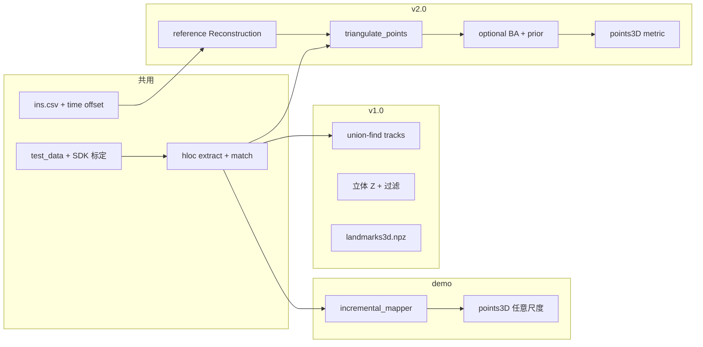

# v2.0 方案：Rig 双目 + INS 已知位姿三角化（及可选 BA）

本文描述在 **`v2.0/`** 中落地「**每个 timestamp = 一个 rig（2 相机）** → hloc pairs/matches → **跳过 incremental mapper** → **global triangulation +（可选）BA**」的**具体实现思路**。目标产物与 `hloc/demo` 一致：**COLMAP 模型目录**（`cameras.bin` / `images.bin` / `points3D.bin` …），可直接 **`localize_sfm`**，但 **尺度来自 INS/立体标定**、点云 **更稀疏、更稳**。

---

## 1. 为什么要这条线

| 路线 | 优点 | 问题 |
|------|------|------|
| **demo：`incremental_mapping`** | 与 hloc 教程一致；`localize_sfm` 零改动 | RobotCar 前向行车常 **无好 initial pair**；尺度 **任意**；与 INS 无关 |
| **v1.0：自研 track + 立体 lift** | 点少、metric、可控过滤 | 产物是 **`landmarks3d.npz`**，**不是** COLMAP 模型；定位需另接或写适配层 |
| **v2.0：已知位姿三角化** | 复用 hloc **DISK+LightGlue + matches**；输出 **标准 SfM**；位姿 **INS 初始化** | 需正确建 **reference reconstruction**、Rig/相机模型、**INS 时钟偏移**；BA/prior 需调参 |

hloc 已具备关键积木：`triangulation.main()` 在 **reference 模型位姿固定** 的前提下调用 `pycolmap.triangulate_points()`（见 `hloc/triangulation.py`）。官方 **RobotCar pipeline** 也是「SIFT 空模型 + covisibility pairs + triangulation」，但 reference 来自 **NVM 离线模型**，不是 INS。v2.0 的替换点：**reference = INS + 外参 + 针孔内参（去畸变图）**。

---

## 2. 与 v1.0 / demo 的边界



- **复用 v1.0**：`stereo_sync`、`interpolate_ins_poses`、`world_pose.world_T_camera`、`CameraModel` 去畸变、**`DEFAULT_INS_TIME_OFFSET_US = 12_180_000`**（见 `v1.0/docs/PHASE_WINDOW_LANDMARK.md` §3.6.4）。**不要**在未补偿偏移的情况下把 INS 写进 COLMAP。
- **复用 v1.0 竖切经验**：pairs 规则（同 ts 立体 + 时间链）、`matching_scores0` 门槛、去畸变图跑 hloc。
- **不重复 v1.0 的** Python track 图 + 手工 lift（除非做 ablation）；三角化交给 COLMAP track 与重投影误差。
- **替换 demo 的** `reconstruction.main` / `incremental_mapping` 作为 **建图主路径**（定位仍可照旧读 `points3D.bin`）。

---

## 3. Rig 与 COLMAP 数据模型（pycolmap 4.x）

### 3.1 语义

- **Rig 实例** = 某一 **timestamp** 上的 **车体/INS 位姿**（rig from world）。
- **Sensor 0 / 1** = **wide left**、**wide right**（同 ts 两张图）；内参各一个 `Camera`（参数相同，**外参相对 rig 固定**）。
- **可选扩展**：centre narrow 作为第三 sensor（**不要**与 wide 混为「立体对」建深度，v1.0 已说明）；v2.0 第一版 **仅 2 相机**。

### 3.2 API 选型（实现时二选一，推荐 A）

| 方案 | 做法 | 优点 | 注意 |
|------|------|------|------|
| **A. 正式 Rig + Frame** | `add_rig` → 两 sensor 的 `sensor_from_rig`；每 ts `add_frame(rig_from_world)`；每图 `add_image` 挂到 frame + camera_id | 与 COLMAP 3.9+ 一致；BA 可 `refine_sensor_from_rig` | 需查清 pycolmap 4.x 下 **image↔frame** 写入顺序 |
| **B. 简化：每图独立位姿** | 每图 `add_image_with_trivial_frame`，`cam_from_world` = 完整 **T_world←cam**（已含 left/right 外参） | 与 hloc `geometric_verification(reference, …)` **直接兼容**；实现快 | 未显式共享 rig；BA 时 rig 约束弱 |

**建议：** 竖切 POC 用 **B** 快速打通 `triangulation.main`；验证定位无误后再 refactor 为 **A**，并在 BA 里 **固定 `sensor_from_rig`**（只微调 `rig_from_world` 或加 prior）。

### 3.3 坐标系

完整推导与 `rig_from_world` 计算见 **§7**。摘要：

- **World**：INS northing/easting/down + RPY，再 **相对首 keyframe** 原点。  
- **Rig**：取 INS body；左右为固定 `sensor_from_rig`。  
- **COLMAP**：Frame 写 `rig_from_world`；或简化为每图直接写 `cam_from_world`。  
- **图像**：去畸变 RGB；`Camera` = **PINHOLE**（SDK 去畸变后 \(f_x,f_y,c_x,c_y\)），COLMAP 内不再畸变。

---

## 4. 图像目录与命名

与 v1.0 window 一致，便于复用脚本：

```text
outputs/rig_sfm/images/
  left/{timestamp}.png
  right/{timestamp}.png
```

hloc `image_list`：**所有 left + 所有 right**（顺序任意，pairs 文件决定匹配）。

COLMAP **`image_dir`** = `images/` 根目录；**`image.name`** = `left/1400….png`（与 `features.h5` / `matches.h5` 键一致）。

---

## 5. Pairs 生成（Rig 时间 + 立体）

Keyframe 与 pairs **按光心几何选**，不要只按固定帧间隔（前向行车时相邻帧三角化角过小，见 §8.5）。**单张地图与 track 传递**见 §9。

**Keyframe 建议：** 相对上一 KF，平移 \(\ge d_{\min}\)（如 0.75–2 m）或 \(|\Delta\mathrm{yaw}| \ge \theta_{\min}\)；弯道可加密。

在 keyframe 集合 \(\{t_k\}\) 上：

| 类型 | 规则 | 作用 |
|------|------|------|
| **立体（必加）** | 每个 \(t_k\)：`left/t_k` ↔ `right/t_k` | **主 metric / 主抗前向退化**（横向基线） |
| **时间 · 同目** | `left/t_i` ↔ `left/t_{i+g}`，\(g=1..G\)，且光心距 \(\ge d_{\min}\) | 拉长纵向基线、加长 track |
| **时间 · 同目** | 右目同理 | 对称 |
| **跨目 · 可选** | `left/t_i` ↔ `right/t_j`（\|i−j\| 小） | 横纵基线耦合；**控制数量** |

输出：`pairs-stereo.txt`、`pairs-temporal-*.txt`、`pairs-all.txt`。

**不做：** `pairs_from_exhaustive`（避免 O(n²)）。

---

## 6. hloc 阶段（与 demo 相同 conf）

工作目录：`v2.0/outputs/rig_sfm/`（全流水线统一）。

1. 准备去畸变 left/right 图 + keyframes + pairs（§4–§5）。
2. **`extract_features.main`**：`disk`，`resize_max=1600`。
3. **`match_features.main`**：`disk+lightglue`，pairs = `pairs-all.txt`。
4. 可选：`min_match_score=0.1`（import 时过滤）。

运行环境：`v2.0/.venv-schubki-v2`（Jupyter：**SchubKI v2.0 (rig+hloc)**），`chdir` 到 `Hierarchical-Localization`，`KMP_DUPLICATE_LIB_OK=TRUE`。

---

## 7. 步骤 B — 写 reference Reconstruction（位姿已知，点为空）

### 7.1 目的

写出 **`reference/`** 目录，供步骤 C 的 `triangulation.main(..., reference_model=reference)` 使用：

| 内容 | 状态 |
|------|------|
| `cameras.bin` | 左/右 PINHOLE 内参 |
| `images.bin` | 每张图 **已注册** + 已知 `cam_from_world`（或由 Frame 推出） |
| `frames.bin` / `rigs.bin` | 若用正式 Rig（§3.2 方案 A） |
| `points3D.bin` | **空**（三角化在步骤 C 填充） |

**不做**增量位姿估计；位姿全部来自 INS + 外参 + 时间对齐。

模块建议：`v2.0/mapping/build_reference_colmap.py`。

### 7.2 坐标系约定（本方案定义）

| 符号 | 含义 | 数据 |
|------|------|------|
| **World \(W_0\)** | INS 原始平面系 | `ins.csv` 的 northing, easting, down（米） |
| **World \(W\)** | 建图世界系 | \(W_0\) **相对首 keyframe \(t_0\)** 后的系（数值稳定） |
| **Rig \(R\)** | 多相机刚体原点 | **取 INS body**（与 RobotCar 外参位姿源一致） |
| **Cam \(C_L,C_R\)** | 去畸变后左右针孔 | SDK `models/` + `extrinsics/` |

COLMAP 命名：

- **`rig_from_world`** \(= T_{R\leftarrow W}\)：世界点 → rig 坐标。  
- **`sensor_from_rig`** \(= T_{C\leftarrow R}\)：固定外参（左右各一）。  
- **`cam_from_world`** \(= T_{C\leftarrow R}\,T_{R\leftarrow W}\)。

与「rig 在世界中的位姿」互逆：

\[
\texttt{rig\_from\_world}
=
\bigl(T_{W\leftarrow R}\bigr)^{-1}.
\]

### 7.3 `rig_from_world` 如何计算

对每个 keyframe 图像时间戳 \(t_{\mathrm{img}}\)：

**（1）时间对齐**

图像与 INS 时钟一般不一致。先标定常数（或缓变）偏移 \(\Delta\)：

\[
t_{\mathrm{ins}} = t_{\mathrm{img}} - \Delta.
\]

\(\Delta\) 为本方案标定参数（轨迹 yaw-rate 互相关、或网格搜索使极线内点/重投影最优）。**未补偿 \(\Delta\) 时不要写 reference。**

**（2）INS 行 → \(T_{W_0\leftarrow R}\)**

在 `ins.csv` 于 \(t_{\mathrm{ins}}\) 插值（位置线性；旋转 **SLERP**，避免欧拉角线性插）：

\[
\mathbf{p}=(n,e,d),\quad
R_{W_0\leftarrow R}=\mathrm{Rot}(\mathrm{roll},\mathrm{pitch},\mathrm{yaw})
\]

（欧拉约定必须与 SDK `build_se3_transform(xyzrpy)` / 外参文件一致。）

\[
T_{W_0\leftarrow R}(t)
=
\begin{bmatrix} R_{W_0\leftarrow R} & \mathbf{p} \\ 0 & 1 \end{bmatrix}.
\]

**（3）相对化到建图世界 \(W\)**

取首 KF \(t_0\)：

\[
T_{W\leftarrow R}(t)
=
T_{W_0\leftarrow R}(t_0)^{-1}\,
T_{W_0\leftarrow R}(t).
\]

则 \(t_0\) 处 rig 位姿为单位；平移为米制相对坐标。

**（4）写入 COLMAP**

\[
\boxed{
\texttt{rig\_from\_world}(t)
=
T_{W\leftarrow R}(t)^{-1}
=
\begin{bmatrix}
R^\top & -R^\top\mathbf{p}_W \\
0 & 1
\end{bmatrix}
}
\]

转为 `Rigid3d`（四元数 + 平移）挂到该 ts 的 **Frame**。

**（5）左右相机**

固定外参 \(T_{C\leftarrow R}^{L/R}\)（SDK extrinsics；若针孔系与 SDK 相机系差固定 \(G\)，并入 `sensor_from_rig` 一次）：

\[
\texttt{cam\_from\_world}^{L/R}(t)
=
T_{C\leftarrow R}^{L/R}\,
\texttt{rig\_from\_world}(t).
\]

- **正式 Rig：** Frame 存 `rig_from_world`；Image 挂 Frame + `sensor_from_rig`。  
- **简化路径：** 不建 Rig 对象，每张图直接写上式的 `cam_from_world`（与 hloc `geometric_verification` 直接兼容）。

### 7.4 逐步写入 checklist

```text
对每个 keyframe t_img:
  1. t_ins ← t_img - Δ
  2. 插值 ins.csv → T_W0←rig
  3. 相对化 → T_W←rig → rig_from_world = inv(T_W←rig)
  4. 若 Rig：add_frame(rig_from_world)；左右 Image 挂 frame
     若简化：直接写 cam_from_world^{L/R}
  5. Camera：PINHOLE(fx,fy,cx,cy) 来自去畸变后模型；left/right 各一（或共享内参、仍两路 Image）
  6. points3D 保持空；图像 registered = true
保存 reference/
```

### 7.5 验收

- `num_reg_images() = 2 × N_keyframes`。  
- 可视化相机轨迹与车辆前进方向一致；同 ts 左右光心距 ≈ 立体基线。  
- 相邻 KF 光心距量级与 \(d_{\min}\) / 车速相符。  
- 抽一对立体图算极线：正确匹配应多数过阈值（为步骤 C 做冒烟）。

---

## 8. 步骤 C — 已知位姿几何验证 + 三角化

替代 demo 的 `incremental_mapping`：位姿已由步骤 B 给定，本步只把 **匹配 → 可靠 3D 路标**。

### 8.1 目的

| 目标 | 说明 |
|------|------|
| **洗净匹配** | 在已知相对位姿下用极线误差剔误匹配（比盲目估 \(E\) 的 RANSAC 稳） |
| **生成 metric 地图** | 多视图三角化得到 `points3D`，尺度来自 INS/立体（米） |
| **可查询** | 回填每图 `point3D_id`，产物与 hloc/demo 的 `sfm/` **同构**，直接 `localize_sfm` |
| **可控** | 用立体边 + 大基线时间边 + `min_tri_angle` 抑制前向病态点 |

与增量 SfM 对比：不估位姿、不选 initial pair；失败模式转为 INS/\(\Delta\)/外参错误，而非初始化失败。

### 8.2 总流程

```text
reference/（有位姿、无点）+ features.h5 + matches.h5 + pairs-all.txt
    │
    ▼
① create_db_from_model → database.db（cameras / images 位姿 / 可选 rigs·frames）
    │
    ▼
② import_features / import_matches（候选 2D–2D，未验证）
    │
    ▼
③ geometric_verification：已知 T_cam1←cam0 → 极线误差 → inlier matches
    │
    ▼
④ triangulate_points：track → DLT/中点初值 → 重投影优化 → points3D + point3D_id
    │
    ▼
⑤ （可选）BA；后处理过滤 → sfm/
```

入口：`hloc.triangulation.main`（内部调 `pycolmap.triangulate_points`）。

```python
triangulation.main(
    sfm_dir=output_sfm,
    reference_model=reference_dir,
    image_dir=images_root,
    pairs=pairs_all,
    features=features_h5,
    matches=matches_h5,
    skip_geometric_verification=False,
    estimate_two_view_geometries=False,  # 用已知位姿极线，而非再估两视图几何
    min_match_score=0.1,
    mapper_options={...},
)
```

### 8.3 ①–② Database 与导入

**目的：** 把 reference 位姿与 hloc 特征接入 COLMAP 管道。

1. `create_db_from_model(reference)`：写入 cameras、images（位姿）、若有则 rigs/frames。  
2. `import_features`：关键点写入 DB（hloc 对坐标 **+0.5** 对齐 COLMAP 像素中心；reference 必须与去畸变图一致）。  
3. `import_matches`：按 pairs 写入匹配；可选 `min_match_score`。

此时匹配仍可能含大量外点。

### 8.4 ③ 已知位姿几何验证（算法）

**目的：** 只保留满足对极几何的对应，供三角化。

对 pairs 中每对图 \(I_0,I_1\)：

1. 取已知位姿，算相对变换：

\[
T_{\mathrm{cam1}\leftarrow\mathrm{cam0}}
=
\texttt{cam1\_from\_world}
\;\circ\;
\texttt{cam0\_from\_world}^{-1}.
\]

2. 像素经相机模型到归一化平面；由相对位姿得本质几何 / 极线。  
3. 对每个匹配算 **极线误差**（点到极线距离）。  
4. 误差 ≤ 阈值（如噪声折合后的 ~4 px）→ inlier，写入 `two_view_geometry`；否则丢弃。

实现：`hloc.triangulation.geometric_verification`（`estimate_two_view_geometries=False` 时走此路径）。  
**不要**用默认的盲目 `verify_matches` RANSAC 估 \(E\) 作为主路径——会浪费已知位姿、在前向运动下更不稳。

### 8.5 选哪些图像/边参与三角化（减弱小三角化角）

三角化角 = 两视线（或光心–三维点）夹角；过小则深度沿光轴病态。前向行车时 **同目近邻帧** 夹角经常过小；**同时刻左右** 横向基线与前进方向正交，是主解药。

| 策略 | 做法 |
|------|------|
| 立体边必加 | 每个 KF：`left/t↔right/t` 作为主 metric / 主抗退化约束 |
| KF 按距离/转角 | 平移 \(\ge d_{\min}\) 或 \(\|\Delta\mathrm{yaw}\|\) 够大，勿固定隔 N 帧 |
| 时间边要有跨度 | \(t_i↔t_{i+g}\) 且光心距 \(\ge d_{\min}\)；\(g=1\) 可连通，不宜作唯二视图深度源 |
| 多视图 track | 立体 + 多尺度时间边，让一点有多条非共线视线 |
| 弯道加密 | yaw-rate 高处多留 KF，补大视差 |
| `min_tri_angle` | 如 1°–3°：**主动丢**病态点，勿为凑点数降到 ~0 |
| 后处理偏好 | 优先保留 track **含同 ts 左右观测** 或最大视线夹角 ≥ τ 的点 |

**原则：** 不是少用图，而是少用「几乎共线的视线对」当深度主约束；每个保留的 3D 点应尽量吃到 **横向立体** 或 **足够长的时间基线**。

### 8.6 ④ `triangulate_points`（算法）

**目的：** 在位姿固定（或稍后弱调）下，把 inlier 匹配连成 track 并生成世界系 3D 点。

概念步骤：

1. **建 track：** 跨像对 inlier 匹配的连通分量 = 候选三维点的多帧观测。  
2. **三角化每个 track（观测数 ≥ 2，实践偏好 ≥ 3）：**  
   - 线性初值：多视图 DLT 或两视图中点法；  
   - 非线性：最小化重投影误差  

\[
\min_{\mathbf{X}}
\sum_{v}
\bigl\|
\pi(K_v,\,\texttt{cam\_from\_world}_v\,\mathbf{X})
-
\mathbf{x}_v
\bigr\|^2.
\]

3. **门控：** 重投影过大、点在相机后、**三角化角过小** → 丢弃。  
4. **写回：** `points3D` + 各图 `points2D.point3D_id`。

COLMAP：`pycolmap.triangulate_points`（`clear_points=True` 清空 reference 旧点再填）。

**推荐 options（对照 pycolmap 4.x 字段名）：**

- `min_tri_angle`：1°–3°（前向场景关键）；  
- 第一版 `refine_intrinsics=False`；  
- 短 track / two-view-only：三角化后过滤（§11），或打开忽略两视图 track 类选项。

### 8.7 ⑤ 可选 BA 与后处理（摘要）

详情见 §10–§11。第一版建议：**位姿全固定，只三角化 + 过滤**；正式 Rig 若开 BA，**锁死 `sensor_from_rig`**，仅微调 `rig_from_world` 或加 INS prior。

### 8.8 产物性质

| | demo `incremental_mapping` | 本步骤 C |
|--|---------------------------|----------|
| 位姿 | 估计 | **给定（步骤 B）** |
| 尺度 | 任意 | **米** |
| 匹配验证 | 估 \(E\)+RANSAC | **已知相对位姿 + 极线** |
| 目录 | `cameras/images/points3D` | **同构** → 可直接定位查询 |

---

## 9. 单张 SfM 建图：Pairs、验证与 Track（定位用一份地图）

本节说明 **不做序列竖切、只产出一份 `sfm/` 给定位用** 时，建图在算法上如何串起来；并回答两类常见问题：**某 ts 要和谁做匹配/极线验证**，以及 **未直接匹配的 ts 之间如何共用一个 3D 点**。

### 9.1 端到端建图（与 §6–§8 的关系）

```text
全部 keyframe（left/right × ts）  ──§4 图像──§6 特征/匹配（pairs-all）
        │
        ▼
步骤 B：一份 reference/（所有 KF 位姿，points 空）
        │
        ▼
步骤 C：一次 triangulation.main → 一份 sfm/（全局 points3D + point3D_id）
        │
        ▼
定位：localize_sfm 只读这一份 sfm/（+ 全局 features / 检索）
```

**原则：**

- **reference** 与 **sfm** 各 **一份**，覆盖 **所有** 参与建图的 KF 图像（不按 group 拆多份模型）。  
- **竖切 / 分批** 若仅用于开发调试，只应限制 **日志或 pairs 子集**，不应产出多张互不合并的 `points3D.bin`（否则定位需额外融合）。

### 9.2 某 ts 的特征要和哪些 ts「发生关系」？

分两层：**匹配（pairs）** 与 **极线验证（逐对）**。

| 阶段 | 谁决定 | 含义 |
|------|--------|------|
| **是否尝试对应** | `pairs-all.txt` | 仅 **列在 pairs 里** 的图对才会做特征匹配并写入 DB |
| **是否保留对应** | 步骤 C ③ 极线验证 | 对 **每一对** 已有匹配，用已知 \(T_{\mathrm{cam1}\leftarrow\mathrm{cam0}}\) 算极线误差 → inlier |

对 keyframe 时间戳 \(t_i\)（含 `left/t_i`、`right/t_i`）：

1. **必连：立体** — 同一 \(t_i\) 的 `left ↔ right`（见 §5、§8.5）。  
2. **时间：同目** — \(t_i\) 与 **pairs 中指定的** \(t_{i\pm g}\)（左–左、右–右），优先 **光心距 ≥ \(d_{\min}\)** 的 KF，而非与全场所有 ts 两两配对。  
3. **可选：跨目** — `left/t_i ↔ right/t_j`，\(|i-j|\) 小且控制数量。  
4. **不连：** 未出现在 pairs 里的 \((t_a,t_b)\) **不会** 有匹配、也 **不会** 做该对的极线验证。

因此：**不是**「每个 ts 要对所有竖切 ts 做验证」，而是 **稀疏 pairs 图** 决定 **哪些边** 参与匹配与 2D–2D 几何检验；全局仍可通过 **track 传递** 把远距离 ts 挂到同一 3D 点（见 §9.3）。

**与 keyframe 选取：** 只有选入 KF 集合的 ts 才进入 reference 与建图；非 KF 帧不进 SfM，定位时作为 **查询图** 而非库图。

### 9.3 未直接匹配的 ts 如何共用一个 3D 点？（Track 传递）

**问题：** 若 ts0↔ts1、ts1↔ts2 做了极线验证并留下 inlier，但 **没有** ts0↔ts2 这对，ts0 与 ts2 上的特征能否对应 **同一个** `point3D_id`？

**可以。** 不依赖 ts0↔ts2 **直接** 匹配，而依赖 **track（轨迹）合并** 与 **多视图三角化**。

**机制（对应 §8.6 步骤 1–4）：**

1. 每条 **inlier 2D–2D** 匹配是观测图之间的一条 **边**。  
2. COLMAP 在 **所有 inlier 边** 上建 **track**：若 ts0 特征 A ↔ ts1 特征 B，且 ts1 特征 B ↔ ts2 特征 C，则 A、B、C 若被识别为 **同一连通分量**（同一物理路标），合并为 **一条 track**。  
3. **三角化** 针对 **整条 track**（所有视角的像素 + 已知位姿）估计 **一个** \(\mathbf{X}\)，写入 **一个** `points3D`；track 内每次 2D 观测共享 **同一** `point3D_id`。  
4. 因此 ts0 与 ts2 **无需** 直接极线验证，只要 **经 ts1（或更长链）连通**，且合并后 track 满足 **最小视角数、三角化角、重投影** 等门控。

**示意：**

```text
ts0: 特征 A ──inlier── ts1: 特征 B ──inlier── ts2: 特征 C
         └──────────── 同一 track → 一个 3D 点 X ────────────┘
（无 ts0↔ts2 直接边仍可共点）
```

**何时会失败 / 分裂：**

| 情况 | 结果 |
|------|------|
| ts0↔ts1、ts1↔ts2 均有 inlier，链不断 | 通常 **共点** |
| ts1↔ts2 **断链**（无 inlier 或未进 pairs） | ts0 与 ts2 **各自独立** track，**不**自动共点 |
| 同一路标在 ts1 上匹配到 **两个不同特征** | 可能 **两条 track**、两个 3D 点（重复路标） |
| track 仅 2 视且三角化角过小 | 点被丢弃或极不稳定 |

**对 pairs 设计的含义：** 时间链需在 KF 序列上 **连通**（相邻或多步 \(g\) 的边），使长 track 能形成；**不必** 对任意 \((t_i,t_j)\) 做 \(O(n^2)\) 全对全。立体边在每个 ts 提供 **横向视线**，缓解仅时间邻接时的前向退化（§8.5）。

### 9.4 「验证」一词在本流程中的两种含义

| 说法 | 实际步骤 | 粒度 |
|------|----------|------|
| **极线 / 几何验证** | §8.4，已知位姿下逐 **对** 检验 2D–2D | **边**（pair） |
| **三角化质量验证** | §8.6 + §11 后处理：角、重投影、track 长 | **track**（多视） |

位姿本身来自 **步骤 B（INS）**，不在建图里 RANSAC 重估；「位姿验证」在工程上指 **极线内点率、重投影、与 INS 轨迹一致性**，而非 per-group 重新解算 pose。

### 9.5 与定位的衔接

- 建图完成后，**库图** = `sfm/images.bin` 中已注册且含 `point3D_id` 的 KF（通常 left 为主查询侧，或 left+right 均作库）。  
- **查询图** 不必出现在建图 pairs 中；通过 **检索 + 与库图匹配 → 库图 2D 上的 point3D_id → PnP** 定位（见 `MULTI_VIEW_MAPPING_LOCALIZATION_OPTIONS.md` §5）。  
- 一份 `points3D` 保证 **全局唯一** 的路标 ID，避免多份 SfM 融合问题。

---

## 10. 可选：Bundle Adjustment + INS prior

`triangulate_points` 之后点与位姿已有 metric 初值；可选一步 **全局 BA** 收紧特征噪声与 INS 漂移。

**pycolmap `BundleAdjustmentOptions` 方向：**

| 选项 | 建议初值 | 含义 |
|------|----------|------|
| `refine_rig_from_world` | True（方案 A） | 允许微调每帧 rig 位姿 |
| `refine_sensor_from_rig` | **False** | 立体外参信任 SDK |
| `refine_points3D` | True | 标准 |
| `refine_focal_length` | False | 去畸变 + 固定内参 |
| `constant_rig_from_world_rotation` / 平移子集 | 实验 | 弱 INS 时少自由度 |

**INS prior（若 API 支持 PosePrior / covariance）：**

- 对每 frame 的 **`rig_from_world`**（或每图 `cam_from_world`）加 **先验**，协方差来自 INS 状态（`ins.csv` 无完整协方差时，用 **启发式**：平移 σ ~ 0.05–0.2 m，旋转 σ ~ 0.5°）。
- 实现路径：查 pycolmap 4.x **`PosePrior`** 是否可挂到 `Frame`；若无，**折中** = BA 里 **强先验**（大权重）或 **仅 refine points3D、位姿全固定**（第一版最稳）。

**第一版建议：** **triangulation only，位姿固定** → 与 reference 完全一致 → 调试最简单；第二版开 **只 refine points3D** 或 **小幅 refine rig_from_world + prior**。

---

## 11. 后处理与「点更少、更稳」

在 `points3D.bin` 写出后（或 triangulation 选项内）：

| 手段 | 说明 |
|------|------|
| **最小 track length** | ≥3（与 v1.0 一致）；COLMAP summary 有 mean track length |
| **最大重投影误差** | 删除 `error` > 4–8 px 的 point |
| **最小 triangulation angle** | 利用 point 的 `track` 多视角几何 |
| **立体一致性（可选）** | 对含 left+right 同 ts 观测的 track，检查两视差推深度差（需后处理脚本，非 COLMAP 内置） |
| **ROI / mask** | 排除天空、引擎盖（RobotCar 经典问题） |

目标数量级：10 keyframe × 2 目 → **10³–10⁴ points**（demo 同规模 4788 @ 10 左目；rig+过滤可相当或略少但 **reproj 更稳**）。

---

## 12. 输出布局与 demo 对齐

```text
v2.0/outputs/rig_sfm/
  images/…
  keyframes.json
  pairs-*.txt
  features.h5
  matches.h5
  reference/          # INS 位姿，points 空
  sfm/                # triangulation.main 的 sfm_dir
    cameras.bin
    images.bin
    points3D.bin
    frames.bin / rigs.bin   # 若使用 Rig API
  sfm_ba/             # 可选 BA 后
```

**定位：** 复制 demo notebook 中 `localize_sfm.main(model=sfm/, …)`，`query` 仍用左目（或 rig 左 sensor）；**地图目录** 指向 `sfm/` 或 `sfm_ba/`。

**尺度：** 世界单位 = **米**（UTM 相对原点），与 v1.0 landmark 同一量级；demo 的 SfM 需 **Sim(3) 对齐** 才能与 INS 比。

---

## 13. 建议代码目录与任务拆分

```text
v2.0/
  README.md
  docs/RIG_KNOWN_POSE_TRIANGULATION.md   # 本文
  mapping/                             # 或 PYTHONPATH 引用 v1.0/mapping
    # pairs：见 v2.0/src/rig_pairs（Python 包 rig_pairs）
    build_reference_colmap.py          # §7 步骤 B：INS → reference/
    post_filter_model.py               # §11 重投影 / track len
  scripts/
    prepare_rig_sfm.sh                 # 图像 + pairs（§4–§5）
    run_hloc_rig.sh                    # extract + match（§6）
    run_triangulation_ins.sh           # 步骤 B+C：reference + triangulation.main
    run_ba_ins.sh                      # 可选 BA（§10）
  outputs/rig_sfm/                     # 运行产物
```

| 阶段 | 任务 | 完成标准 |
|------|------|----------|
| **P0** | 步骤 B+C：10 KF × 2 目，reference + `triangulation.main`，**无 BA** | `points3D.bin` 非空，mean reproj ~1–3 px |
| **P1** | `localize_sfm` 接 query | 定位 inlier 与 demo 同级或更好 |
| **P2** | §11 过滤 + 可选 BA | 点数下降、reproj 改善；位姿相对 INS < 阈值 |
| **P3** | 正式 Rig API + 跨目 pairs 消融；立体观测偏好过滤 | 文档化是否值得 |

---

## 14. 风险与开放问题

1. **INS 时钟偏移 \(\Delta\)**：步骤 B 必标定（§7.3）；未补偿禁止写 reference。  
2. **hloc keypoint +0.5**：与去畸变 PINHOLE 一致（§8.3）。  
3. **pycolmap 4.x**：`triangulate_points` / Rig·Frame API；勿混旧版 option 字典。  
4. **前向 degeneracy**：按 §8.5 选立体边 + 大基线时间边 + `min_tri_angle`；弯道加密。  
5. **npz 导出**：若需自研格式，可从 `points3D` + `features.h5` 导出（非 P0）。  
6. **Centre 第三相机**：仅作小基线辅助 sensor，不替代 wide 立体对。

---

## 15. 参考代码位置（仓库内）

| 组件 | 路径 |
|------|------|
| hloc 三角化入口 | `hloc/Hierarchical-Localization/hloc/triangulation.py` → `main`, `geometric_verification` |
| hloc RobotCar（reference 来自 NVM） | `hloc/.../pipelines/RobotCar/pipeline.py` |
| demo 增量 SfM（v2 替换对象） | `hloc/demo hloc.ipynb` + `hloc/reconstruction.py` |
| v1.0 INS / 相机 / 偏移 | `v1.0/mapping/world_pose.py`, `paths.py`, `docs/PHASE_WINDOW_LANDMARK.md` |
| v1.0 pairs / prepare | `v1.0/mapping/tracks/window.py`, `scripts/prepare_window.py` |

---

*文档版本：v2.0；§7 步骤 B、§8 步骤 C、§9 单张 SfM（pairs / track）已展开。实现时更新 §13 状态表。*
